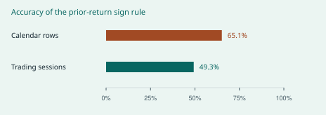
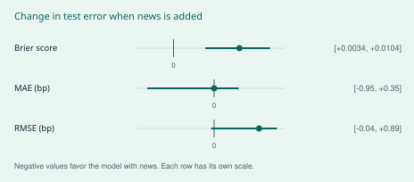

RESEARCH REPORT

# Do financial headlines predict the S&P 500?

A trading-session alignment audit and chronological forecast test

### Abstract

Across 1,320,380 headline scores, we tested whether news improves forecasts of the S&P 500's next close-to-close return. The original calendar join repeated the target session on 31.1% of rows. A prior-return sign rule scored 65.1% on the calendar rows and 49.3% after grouping by session. In a chronological test with a conservative news cutoff, adding headline features worsened directional probability forecasts and left mean absolute error for return magnitude practically unchanged.

### Data and unit of observation

The supplied aggregate covers 3,297 publication dates from 2014-12-22 to 2023-12-31. Each date maps to the first subsequent market session recorded in the source, yielding 2,271 unique target sessions from 2014-12-23 to 2024-01-02. We evaluate forecasts ending in 2023. The later target is counted only in the source audit.

The input contains headline count, mean sentiment, population standard deviation of sentiment, and the S&P 500 close-to-close return assigned to each publication date. The archived scoring script uses VADER with a custom financial term list. The submitted scored-headline sample is available for inspection. All reported results start from the bundled daily aggregate.

| Question | Measure |
| --- | --- |
| Does tone track index returns? | Pearson correlation with the preceding and assigned sessions. |
| Does news improve directional forecasts? | Brier score, ROC-AUC and classification accuracy. |
| Does news improve return-magnitude forecasts? | MAE and RMSE for absolute close-to-close returns. |

01   DATA ALIGNMENT

## How the target leaked

The source maps Friday, Saturday and Sunday to Monday whenever Monday is the next trading day. On the weekend rows, shifting the return down by one publication row can reveal Monday's return before it occurs. We counted 1,026 rows whose assigned target session matched the preceding row's target session.

| Headline publication date | Assigned target session | Assigned return |
| --- | --- | --- |
| 2023-01-06 | 2023-01-09 | -0.077% |
| 2023-01-07 | 2023-01-09 | -0.077% |
| 2023-01-08 | 2023-01-09 | -0.077% |

Figure 1. Both samples use target dates in 2022-2023. Calendar accuracy weights 728 publication rows. Session accuracy gives equal weight to 501 sessions. The calendar rule correctly classifies 227 of 227 rows that repeat the preceding target session.

### Pooling and descriptive associations

We pool publication dates by assigned session and weight headline scores by article count. Dispersion is reconstructed from the pooled first and second moments, including differences in average sentiment between the dates pooled into a session.

Through 2023, average tone had a Pearson correlation of +0.143 with the preceding session's return and -0.030 with the assigned session's return. Dispersion and assigned absolute return had a correlation of +0.198 overall and +0.094 in the test period. These descriptive pairings use date-aligned news, which can include articles published after the preceding close.

02   FORECAST DESIGN AND RESULTS

## What the model could know

Each forecast uses information available at the close of the preceding recorded session. Headlines are admitted only if their recorded publication date is strictly earlier than that cutoff session. For a normal Friday-close to Monday-close target, the newest eligible headline is dated Thursday. This buffer excludes Friday and weekend news because the input has dates without dependable intraday publication times.

After a return-history warm-up, we fit once on 1,749 sessions (2015-01-23 to 2021-12-31) and test on 501 sessions (2022-01-03 to 2023-12-29). In the test period, 48.9% of returns were positive. We standardize predictors using training data and keep the fitted models fixed while updating features with newly observed market history.

The market-only model uses the preceding return, the mean of the last 5 returns and mean absolute returns over 5 and 20 sessions. The same model with news adds buffered mean sentiment, dispersion and log headline count. Both models use linear least squares. Direction probabilities are clipped to [0, 1], with 0.5 as the class threshold. Absolute-return forecasts are floored at zero.

### Directional forecasts

| Model | Accuracy | ROC-AUC | Brier score |
| --- | --- | --- | --- |
| Constant baseline | 48.90% | 0.500 | 0.2533 |
| Market history | 50.50% | 0.492 | 0.2576 |
| Market history + news | 49.10% | 0.490 | 0.2647 |

The constant probability is the training share of up sessions. Lower Brier scores indicate better probability forecasts. Both fitted models score worse than this baseline.

### Absolute-return forecasts

| Model | MAE (pp) | RMSE (pp) |
| --- | --- | --- |
| Constant baseline | 0.6436 | 0.9402 |
| Market history | 0.6059 | 0.7989 |
| Market history + news | 0.6059 | 0.8053 |

The constant forecast is the training median absolute return. Mean absolute error (MAE) and root mean square error (RMSE) are in percentage points of index return. Market history reduces both. Adding news leaves MAE almost identical.

03   UNCERTAINTY AND REPRODUCIBILITY

## What the evidence supports

Adding news raises the Brier score by 0.0071. The increase also appears in each test year. Absolute-return error changes little, with the MAE difference changing sign between the two years. The correlation of buffered disagreement with absolute return falls to +0.044 on the test sessions.

Figure 2. News model minus market-only model, with paired 95% percentile intervals from 2,000 moving-block resamples of 10 consecutive test sessions. One basis point (bp) is 0.01 percentage point. Intervals describe test-period uncertainty conditional on the fitted models.

### Scope of the conclusion

The results apply to this headline corpus, daily index targets and these linear models. Earlier project iterations examined the same years, so this is a retrospective test rather than an independent confirmation. The cutoff sacrifices recent news to respect the available dates. Absolute return is a daily magnitude proxy. Some headlines concern individual companies, and the scoring extension has no independent human-labeled validation in this submission.

### Reproduce the results

From the project root, install requirements.txt and run python scripts/news_research.py, then python scripts/generate_pdf_report.py. The first command records predictions and dates in datasets/holdout_predictions.csv and computed metrics and the input hash in datasets/research_results.json. The second renders both reports and figures from those metrics. The full raw headline archive and original index file are unavailable in this submission.
